# 10. Sơ đồ Use Case & Đặc tả Use Case

Hệ thống **Thuyết minh tự động đa ngôn ngữ — Chùa Linh Ứng Bãi Bụt**.
Nội dung đối chiếu với code thật (`app/api/v1/endpoints/*`, `app/services/*`, `frontend/*`).

## 10.1 Sơ đồ Use Case tổng quát

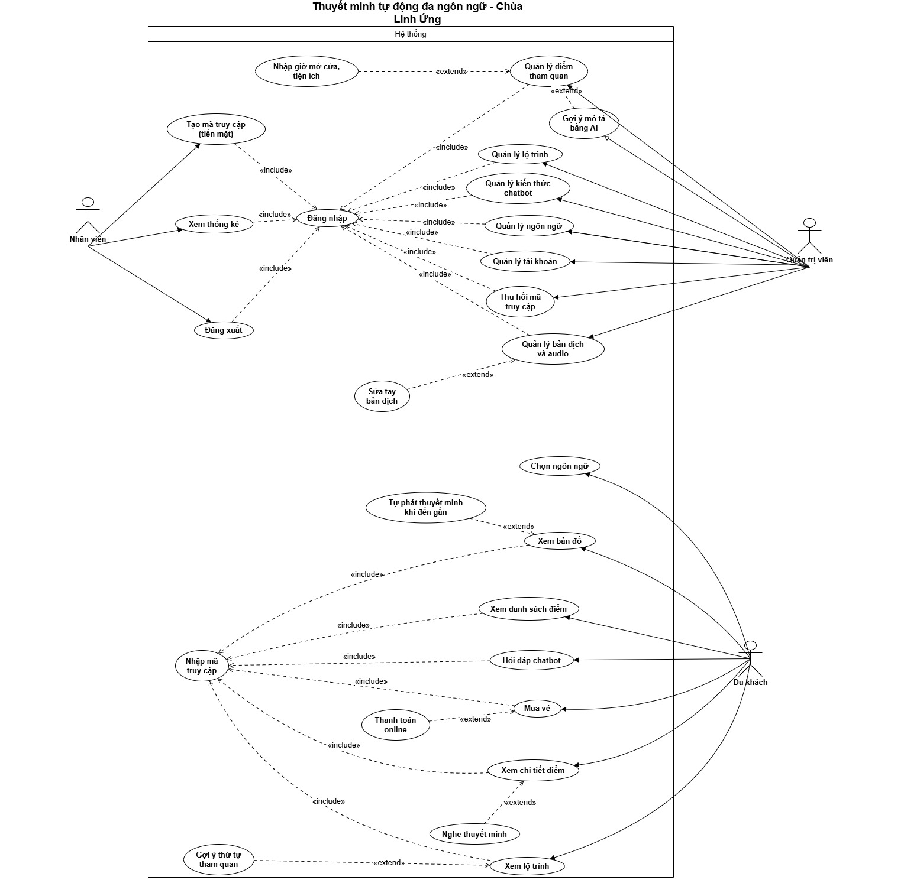

Mã nguồn sơ đồ: [`use-case/so-do-use-case.puml`](use-case/so-do-use-case.puml) — mở bằng draw.io (*Arrange → Insert → Advanced → PlantUML*) hoặc plugin PlantUML của VS Code.

### Tác nhân

| Tác nhân | Loại | Mô tả |
|---|---|---|
| Du khách | Chính | Người tham quan dùng app trên điện thoại (cần mã truy cập) |
| Nhân viên | Chính | Bán vé tại quầy, theo dõi thống kê (role `staff`) |
| Quản trị viên | Chính | Kế thừa toàn bộ quyền Nhân viên + quản trị nội dung, hệ thống (role `admin`) |
| Cổng thanh toán | Phụ | Hệ thống ngoài xử lý thanh toán online, gọi lại webhook có chữ ký |

### Danh sách use case

| Mã | Use case | Tác nhân | API chính |
|---|---|---|---|
| UC01 | Chọn ngôn ngữ | Du khách | `GET /languages`, `GET /ui-strings/{lang}`, `GET /content/bundle` |
| UC02 | Mua vé online (gồm Thanh toán online) | Du khách, Cổng thanh toán | `POST /access/online`, `POST /payments/webhook` |
| UC03 | Nhập mã truy cập | Du khách | `POST /access/token` |
| UC04 | Xem bản đồ (mở rộng: Tự phát thuyết minh khi đến gần) | Du khách | `GET /content/bundle`, `POST /events` |
| UC05 | Xem danh sách điểm | Du khách | `GET /content/bundle` |
| UC06 | Xem chi tiết điểm (mở rộng: Nghe thuyết minh) | Du khách | `GET /pois/{id}/insights`, `POST /pois/{id}/localizations/{lang}/ensure` |
| UC07 | Xem lộ trình (mở rộng: Gợi ý thứ tự tham quan) | Du khách | `GET /tours`, `POST /tours/recommend` |
| UC08 | Hỏi đáp chatbot | Du khách | `POST /chat` |
| UC09 | Đăng nhập | Nhân viên, Quản trị viên | `POST /admin/auth/login` |
| UC10 | Đăng xuất | Nhân viên, Quản trị viên | (xóa token phía trình duyệt) |
| UC11 | Tạo mã truy cập (tiền mặt) | Nhân viên | `POST /admin/access-codes` |
| UC12 | Tra cứu mã truy cập | Nhân viên | `GET /admin/access-sessions` |
| UC13 | Xem thống kê | Nhân viên | `GET /admin/stats`, `GET /admin/chat-logs` |
| UC14 | Quản lý điểm tham quan (mở rộng: Nhập giờ mở cửa/tiện ích, Gợi ý mô tả bằng AI) | Quản trị viên | `/admin/pois`, `POST /admin/ai/enhance-description` |
| UC15 | Quản lý bản dịch và audio (mở rộng: Sửa tay bản dịch) | Quản trị viên | `/admin/pois/{id}/localizations`, `/localize`, `/localize-all` |
| UC16 | Quản lý lộ trình | Quản trị viên | `/admin/tours` |
| UC17 | Quản lý kiến thức chatbot | Quản trị viên | `/admin/knowledge` |
| UC18 | Quản lý ngôn ngữ | Quản trị viên | `PATCH /admin/languages/{code}` |
| UC19 | Quản lý tài khoản | Quản trị viên | `/admin/users` |
| UC20 | Thu hồi mã truy cập | Quản trị viên | `POST /admin/access-sessions/{id}/revoke` |

---

## 10.2 Đặc tả Use Case — phía Du khách

### UC01 — Chọn ngôn ngữ

| | |
|---|---|
| **Use Case Number:** | UC01 |
| **Use Case Name:** | Chọn ngôn ngữ |
| **Actor(s):** | Du khách |
| **Maturity:** | Focused |
| **Summary:** | Du khách chọn 1 trong 16 ngôn ngữ; giao diện, nội dung thuyết minh và audio đổi theo. Ngôn ngữ chưa có bản dịch được hệ thống tự dịch ở nền. |

**Basic Course of Events:**

| Actor action | System Response |
|---|---|
| 1. Mở app, bấm ô chọn ngôn ngữ ở góc phải | |
| | 2. Hiển thị danh sách 16 ngôn ngữ đang bật (tên bản địa: 日本語, 한국어…) |
| 3. Chọn một ngôn ngữ (vd 日本語) **A1** | |
| | 4. Tải nhãn giao diện của ngôn ngữ đó, đổi toàn bộ nút/tab/thông báo. **E1** |
| | 5. Tải dữ liệu nội dung theo ngôn ngữ mới (gửi ETag, dữ liệu không đổi thì dùng bản đã lưu). **A2** |
| | 6. Hiển thị bản đồ, danh sách điểm, lộ trình bằng ngôn ngữ đã chọn và lưu lựa chọn cho lần sau |

**Alternative Paths:**

**A1** — Chọn tiếng Việt hoặc English

| Actor action | System Response |
|---|---|
| 1. Chọn Tiếng Việt / English | |
| | 2. Dùng ngay bộ nhãn có sẵn trong app, không cần tải từ máy chủ |

**A2** — Ngôn ngữ chưa có bản dịch

| Actor action | System Response |
|---|---|
| | 1. Xếp hàng dịch + tạo audio ở nền cho các điểm còn thiếu |
| | 2. Tạm hiển thị bản dự phòng (English → Tiếng Việt) kèm thông báo "Đang dịch nội dung sang ngôn ngữ bạn chọn…" |
| 3. Tiếp tục sử dụng app bình thường | |
| | 4. Cứ vài giây tải lại; dịch xong thì tự thay nội dung và báo "Đã chuyển sang ngôn ngữ bạn chọn" |

**Exception Paths:**

- **E1.** Mất mạng hoặc dịch nhãn lỗi → dùng bộ nhãn đã lưu lần trước, không có thì dùng tiếng Anh.

**Activity:**

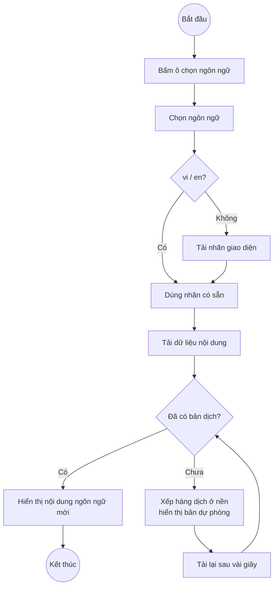

---

### UC02 — Mua vé online

| | |
|---|---|
| **Use Case Number:** | UC02 |
| **Use Case Name:** | Mua vé online (bao gồm Thanh toán online) |
| **Actor(s):** | Du khách, Cổng thanh toán |
| **Maturity:** | Focused |
| **Summary:** | Du khách thanh toán qua cổng online để nhận quyền dùng app trong 24 giờ; sau khi thanh toán thành công app tự kích hoạt quyền truy cập. |

**Basic Course of Events:**

| Actor action | System Response |
|---|---|
| 1. Mở app (quét QR ở cổng chùa) | |
| | 2. Hiển thị màn hình mua vé: giá vé (50.000 đ), thời gian dùng (24 giờ), nút "Thanh toán online", ô nhập mã |
| 3. Nhấn "Thanh toán online" | |
| | 4. Tạo phiên truy cập ở trạng thái *chờ thanh toán* + giao dịch, chuyển sang trang cổng thanh toán. **E1** |
| 5. Xác nhận thanh toán trên cổng **A1** | |
| | 6. Cổng thanh toán gọi webhook có **chữ ký HMAC**; hệ thống kiểm tra chữ ký, đổi phiên sang *đã thanh toán*. **E2** |
| | 7. Cổng chuyển khách về app kèm mã truy cập |
| | 8. App tự đổi mã lấy token (UC03) và vào màn hình chính. **A2** |

**Alternative Paths:**

**A1** — Thanh toán thất bại / khách hủy

| Actor action | System Response |
|---|---|
| 1. Chọn "Hủy / thất bại" trên cổng | |
| | 2. Webhook báo thất bại → phiên chuyển *đã hủy* |
| | 3. Chuyển về app, hiển thị "Thanh toán không thành công", khách có thể thử lại |

**A2** — Webhook về chậm hơn khách

| Actor action | System Response |
|---|---|
| | 1. Đổi mã nhận lỗi *thanh toán chưa hoàn tất* (409 `PAYMENT_PENDING`) |
| | 2. Hiển thị "Đang chờ xác nhận thanh toán…", tự thử lại mỗi 2 giây (tối đa 6 lần) |

**Exception Paths:**

- **E1.** Không kết nối được máy chủ → hiển thị thông báo lỗi trên màn hình mua vé.
- **E2.** Chữ ký webhook sai → từ chối 401 `INVALID_SIGNATURE`, phiên giữ nguyên. Webhook bị gọi lặp → bỏ qua (xử lý một lần duy nhất).

**Activity:**

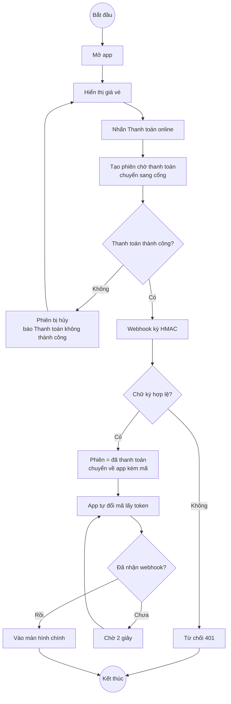

---

### UC03 — Nhập mã truy cập

| | |
|---|---|
| **Use Case Number:** | UC03 |
| **Use Case Name:** | Nhập mã truy cập |
| **Actor(s):** | Du khách |
| **Maturity:** | Focused |
| **Summary:** | Du khách nhập mã 6 ký tự (nhận từ quầy vé hoặc sau thanh toán online) để nhận quyền dùng app. Lần đầu nhập thì bắt đầu tính 24 giờ. |

**Basic Course of Events:**

| Actor action | System Response |
|---|---|
| 1. Nhập mã vào ô "Đã có mã truy cập" (không phân biệt hoa/thường) | |
| 2. Nhấn "Vào" | |
| | 3. Kiểm tra mã. **E1, E2, E3** |
| | 4. Lần đầu dùng mã: kích hoạt, hạn dùng = thời điểm hiện tại + 24 giờ. **A1** |
| | 5. Cấp token, lưu trong trình duyệt |
| | 6. Tải dữ liệu và hiển thị màn hình chính (bản đồ) |

**Alternative Paths:**

**A1** — Mã đã kích hoạt trước đó (khách đổi máy / xóa dữ liệu trình duyệt)

| Actor action | System Response |
|---|---|
| | 1. Mã còn hạn → cấp lại token với hạn dùng cũ, không tính lại 24 giờ |

**Exception Paths:**

- **E1.** Mã không tồn tại → "Mã truy cập không đúng".
- **E2.** Mã đã bị thu hồi → "Mã truy cập đã bị hủy".
- **E3.** Mã quá hạn đổi (chưa dùng sau 24 giờ) hoặc hết thời gian sử dụng → "Mã truy cập đã hết hạn".

**Activity:**

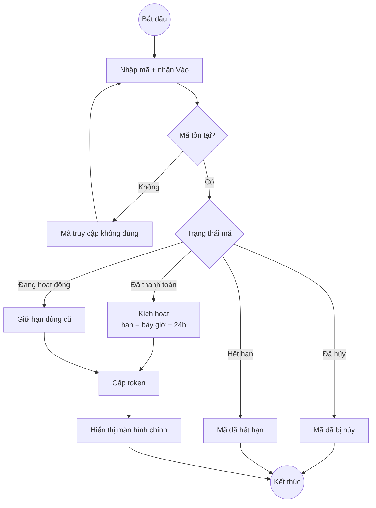

---

### UC04 — Xem bản đồ

| | |
|---|---|
| **Use Case Number:** | UC04 |
| **Use Case Name:** | Xem bản đồ (mở rộng: Tự phát thuyết minh khi đến gần) |
| **Actor(s):** | Du khách |
| **Maturity:** | Focused |
| **Summary:** | Du khách xem các điểm tham quan và vị trí của mình trên bản đồ; khi đi vào vùng của một điểm, app tự mở và phát thuyết minh. |

**Basic Course of Events:**

| Actor action | System Response |
|---|---|
| 1. Mở tab "Bản đồ" | |
| | 2. Hiển thị bản đồ chùa, mỗi điểm là 1 số thứ tự + vòng tròn vùng kích hoạt |
| | 3. Xin quyền và theo dõi vị trí GPS, hiển thị chấm xanh + sai số. **E1** |
| 4. Di chuyển trong khuôn viên chùa | |
| | 5. Liên tục kiểm tra khoảng cách tới các điểm. **A1** |
| 6. Nhấn "Vị trí của tôi" | |
| | 7. Đưa bản đồ về vị trí hiện tại |
| 8. Nhấn vào 1 điểm trên bản đồ | |
| | 9. Mở panel chi tiết điểm (UC06) |

**Alternative Paths:**

**A1** — Tự phát thuyết minh khi đến gần (`<<extend>>`)

| Actor action | System Response |
|---|---|
| | 1. Khách ở trong vùng của điểm **liên tục ≥ 3 giây** (chống nhiễu GPS) |
| | 2. Nhiều vùng chồng nhau → chọn điểm ưu tiên cao hơn, bằng nhau thì chọn điểm gần hơn |
| | 3. Báo "Bạn đang ở gần: …", mở chi tiết và phát audio (nếu bật "Tự phát") |
| | 4. Ghi nhận sự kiện *vào vùng*; cùng một điểm chỉ tự phát lại sau 5 phút; đang phát audio thì không ngắt |

**A2** — Giả lập GPS (khi không ở chùa / demo)

| Actor action | System Response |
|---|---|
| 1. Tick "Giả lập GPS" | |
| | 2. Báo "Đang giả lập: bấm vào bản đồ để đặt vị trí" |
| 3. Bấm lên bản đồ | |
| | 4. Đặt vị trí giả tại điểm bấm, kiểm tra vùng ngay (bỏ qua chờ 3 giây) |

**Exception Paths:**

- **E1.** Không lấy được GPS (từ chối quyền / thiết bị không hỗ trợ) → báo "Không lấy được GPS. Tick Giả lập GPS rồi bấm vào bản đồ để chọn vị trí."

**Activity:**

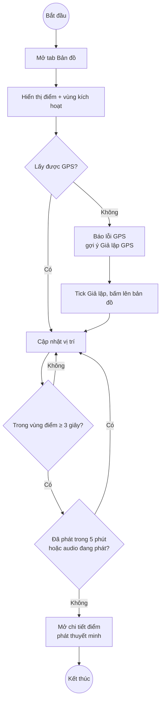

---

### UC05 — Xem danh sách điểm

| | |
|---|---|
| **Use Case Number:** | UC05 |
| **Use Case Name:** | Xem danh sách điểm |
| **Actor(s):** | Du khách |
| **Maturity:** | Focused |
| **Summary:** | Du khách xem toàn bộ điểm tham quan dạng danh sách, sắp theo khoảng cách nếu có vị trí. |

**Basic Course of Events:**

| Actor action | System Response |
|---|---|
| 1. Mở tab "Danh sách" | |
| | 2. Hiển thị các điểm: số thứ tự, tên, có/chưa có audio, ngôn ngữ đang hiển thị (nếu là bản dự phòng). **A1** |
| 3. Nhấn vào 1 điểm | |
| | 4. Mở panel chi tiết điểm (UC06) |

**Alternative Paths:**

**A1** — Đã có vị trí GPS

| Actor action | System Response |
|---|---|
| | 1. Sắp xếp từ gần đến xa, hiển thị khoảng cách (m) của từng điểm |

**Exception Paths:**

- **E1.** Mất mạng → dùng dữ liệu đã lưu lần trước, hiển thị "Offline".

**Activity:**

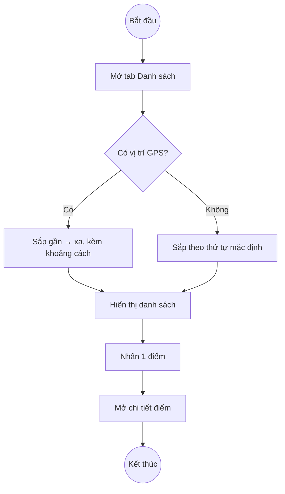

---

### UC06 — Xem chi tiết điểm

| | |
|---|---|
| **Use Case Number:** | UC06 |
| **Use Case Name:** | Xem chi tiết điểm (mở rộng: Nghe thuyết minh) |
| **Actor(s):** | Du khách |
| **Maturity:** | Focused |
| **Summary:** | Du khách xem nội dung thuyết minh và thông tin chi tiết của 1 điểm như trên Google Maps: trạng thái mở cửa, giờ mở cửa, vé, thời gian tham quan, tiện ích, lưu ý, khung giờ đông khách, chỉ đường. |

**Basic Course of Events:**

| Actor action | System Response |
|---|---|
| 1. Chọn 1 điểm (từ bản đồ, danh sách, lộ trình hoặc geofence) | |
| | 2. Hiển thị tên, loại điểm, mô tả theo ngôn ngữ đã chọn. **A1** |
| | 3. Lấy trạng thái theo giờ hiện tại: "Đang mở cửa · Đóng cửa lúc 11:30" / "Sắp đóng cửa" / "Đã đóng cửa · Mở cửa lúc …". **E1** |
| | 4. Hiển thị bảng thông tin: giờ mở cửa hôm nay, vé vào cửa, thời gian tham quan, tiện ích & quy định, lưu ý |
| | 5. Hiển thị biểu đồ khung giờ đông khách của hôm nay. **E2** |
| 6. Nhấn "Xem cả tuần" | |
| | 7. Mở giờ mở cửa đủ 7 ngày (tên thứ theo ngôn ngữ khách) |
| 8. Nhấn nút phát audio **A2, A3** | |
| | 9. Phát thuyết minh, ghi nhận sự kiện *nghe audio* |
| 10. Nhấn "Chỉ đường (Google Maps)" | |
| | 11. Mở Google Maps chỉ đường đi bộ tới điểm |
| 12. Nhấn "Đóng" | |
| | 13. Dừng audio, đóng panel |

**Alternative Paths:**

**A1** — Chưa có bản dịch ngôn ngữ đã chọn

| Actor action | System Response |
|---|---|
| | 1. Hiển thị bản dự phòng (English → Tiếng Việt) kèm nhãn "Chưa có bản dịch, đang hiển thị bằng …" |
| 2. Nhấn "Dịch và tạo audio" | |
| | 3. Dịch + tạo audio ngay cho điểm này, hiển thị lại và tự phát |

**A2** — Điểm chưa có audio

| Actor action | System Response |
|---|---|
| 1. Nhấn "Đọc bằng giọng máy" | |
| | 2. Đọc tên + mô tả bằng giọng đọc của trình duyệt theo ngôn ngữ đang hiển thị |

**A3** — Đổi ngày trong biểu đồ đông khách

| Actor action | System Response |
|---|---|
| 1. Chọn thứ khác trong ô chọn ngày | |
| | 2. Vẽ lại biểu đồ theo ngày đã chọn |

**Exception Paths:**

- **E1.** Mất mạng → vẫn hiện giờ mở cửa từ dữ liệu đã tải, ẩn trạng thái và biểu đồ. Điểm chưa nhập giờ → "Chưa có thông tin".
- **E2.** Dưới 20 lượt ghé thăm trong 8 tuần → "Chưa đủ dữ liệu, cần thêm lượt khách ghé thăm".

**Activity:**

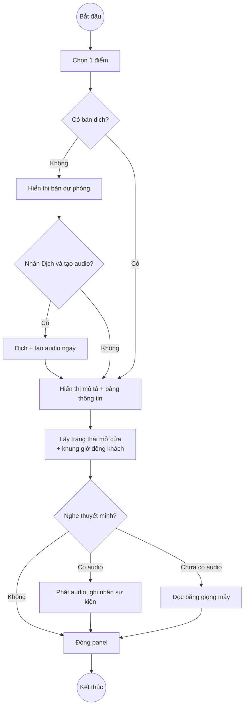

---

### UC07 — Xem lộ trình

| | |
|---|---|
| **Use Case Number:** | UC07 |
| **Use Case Name:** | Xem lộ trình (mở rộng: Gợi ý thứ tự tham quan) |
| **Actor(s):** | Du khách |
| **Maturity:** | Focused |
| **Summary:** | Du khách chọn một lộ trình có sẵn; hệ thống gợi ý thứ tự đi từ vị trí hiện tại, kèm quãng đường và thời gian. |

**Basic Course of Events:**

| Actor action | System Response |
|---|---|
| 1. Mở tab "Lộ trình" | |
| | 2. Hiển thị danh sách lộ trình (vd "Lộ trình cơ bản 30 phút") và lựa chọn "Các điểm chính" |
| 3. Chọn 1 lộ trình | |
| 4. Nhấn "Gợi ý thứ tự đi" **A1** | |
| | 5. Lấy vị trí hiện tại, sắp thứ tự theo điểm gần nhất kế tiếp. **A2, E1** |
| | 6. Hiển thị từng điểm: quãng đường đi bộ, phút đi bộ, phút nghe; tổng quãng đường + tổng thời gian; vẽ đường đi trên bản đồ |
| 7. Nhấn 1 điểm trong lộ trình | |
| | 8. Mở panel chi tiết điểm (UC06) |

**Alternative Paths:**

**A1** — Chọn "Các điểm chính" (không theo lộ trình có sẵn)

| Actor action | System Response |
|---|---|
| | 1. Hệ thống tự chọn các điểm có mức ưu tiên cao nhất để gợi ý |

**A2** — Chưa có vị trí GPS

| Actor action | System Response |
|---|---|
| | 1. Lấy điểm đầu tiên (Cổng Tam Quan) làm điểm xuất phát |

**Exception Paths:**

- **E1.** Lộ trình không còn điểm nào hợp lệ (điểm đã bị xóa/ẩn) → "Không có POI hợp lệ nào để tạo lộ trình".

**Activity:**

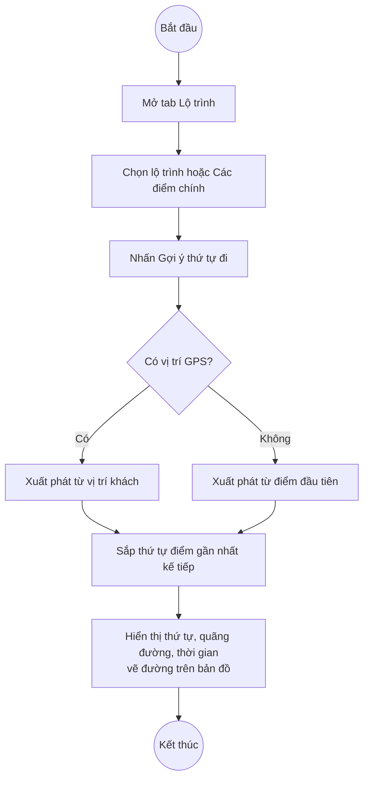

---

### UC08 — Hỏi đáp chatbot

| | |
|---|---|
| **Use Case Number:** | UC08 |
| **Use Case Name:** | Hỏi đáp chatbot |
| **Actor(s):** | Du khách |
| **Maturity:** | Focused |
| **Summary:** | Du khách hỏi bằng ngôn ngữ bất kỳ; hướng dẫn viên ảo (AI tạo sinh) trả lời dựa trên tài liệu của chùa, nhớ ngữ cảnh vài câu trước, chỉ trả lời trong phạm vi Chùa Linh Ứng. |

**Basic Course of Events:**

| Actor action | System Response |
|---|---|
| 1. Mở tab "Hỏi đáp" | |
| | 2. Hiển thị lời chào của hướng dẫn viên ảo |
| 3. Nhập câu hỏi (2–500 ký tự), nhấn "Gửi" | |
| | 4. Kiểm tra số câu đã hỏi trong ngày. **E1** |
| | 5. Gửi cho AI: quy tắc phạm vi + tài liệu của chùa (nội dung điểm, giờ mở cửa, bài viết kiến thức) + giờ hiện tại + vài lượt hỏi đáp trước. **A1, A2** |
| | 6. Hiển thị câu trả lời bằng ngôn ngữ của khách, kèm "Nguồn" là tài liệu được nhắc tới |

**Alternative Paths:**

**A1** — Câu hỏi ngoài phạm vi (lập trình, bài tập, chính trị…)

| Actor action | System Response |
|---|---|
| | 1. Từ chối lịch sự, gợi ý câu hỏi về chùa, không kèm nguồn |

**A2** — AI lỗi / quá tải / chưa cấu hình

| Actor action | System Response |
|---|---|
| | 1. Tìm đoạn tài liệu liên quan nhất (BM25), dịch sang ngôn ngữ khách và trả lời dạng trích đoạn |

**Exception Paths:**

- **E1.** Vượt giới hạn câu hỏi/ngày → 429 "Bạn đã hỏi tối đa N câu hôm nay".

**Activity:**

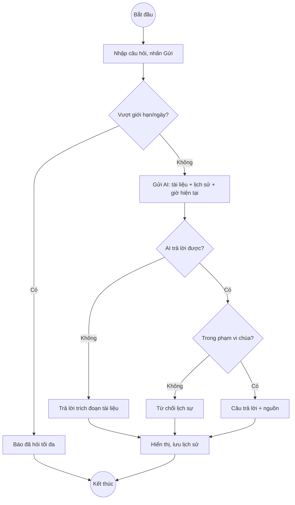

---

## 10.3 Đặc tả Use Case — phía Nhân viên

### UC09 — Đăng nhập

| | |
|---|---|
| **Use Case Number:** | UC09 |
| **Use Case Name:** | Đăng nhập |
| **Actor(s):** | Nhân viên, Quản trị viên |
| **Maturity:** | Focused |
| **Summary:** | Nhân viên / quản trị viên đăng nhập dashboard. Là bước bắt buộc của mọi chức năng quản trị. |

**Basic Course of Events:**

| Actor action | System Response |
|---|---|
| 1. Mở trang `/admin/` | |
| | 2. Hiển thị form "Đăng nhập quản trị" |
| 3. Nhập tên đăng nhập, mật khẩu | |
| 4. Nhấn "Đăng nhập" | |
| | 5. Kiểm tra tài khoản (mật khẩu so khớp bcrypt). **E1, E2** |
| | 6. Cấp token, lưu trong trình duyệt |
| | 7. Hiển thị trang "Tổng quan"; menu theo vai trò (Nhân viên không thấy "Tài khoản"). **A1** |

**Alternative Paths:**

**A1** — Đã đăng nhập trước đó, token còn hạn

| Actor action | System Response |
|---|---|
| 1. Mở lại `/admin/` | |
| | 2. Vào thẳng trang Tổng quan, không cần nhập lại |

**Exception Paths:**

- **E1.** Bỏ trống hoặc sai tên đăng nhập / mật khẩu → "Sai tên đăng nhập hoặc mật khẩu".
- **E2.** Tài khoản bị khóa → "Tài khoản đã bị khóa".

**Activity:**

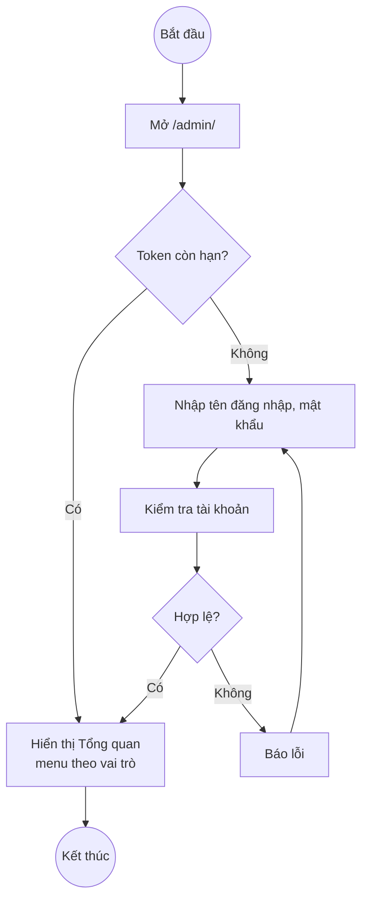

---

### UC10 — Đăng xuất

| | |
|---|---|
| **Use Case Number:** | UC10 |
| **Use Case Name:** | Đăng xuất |
| **Actor(s):** | Nhân viên, Quản trị viên |
| **Maturity:** | Focused |
| **Summary:** | Kết thúc phiên làm việc trên dashboard. |

**Basic Course of Events:**

| Actor action | System Response |
|---|---|
| 1. Nhấn "Đăng xuất" ở thanh trên cùng | |
| | 2. Xóa token khỏi trình duyệt |
| | 3. Quay về form đăng nhập |

**Alternative Paths:**

**A1** — Hết phiên tự động

| Actor action | System Response |
|---|---|
| | 1. Token hết hạn → API trả 401 → tự đăng xuất, báo "Phiên đăng nhập hết hạn" |

**Exception Paths:** Không có.

**Activity:**

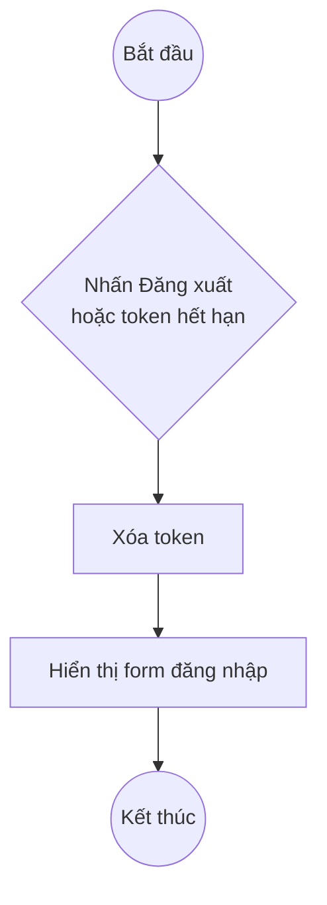

---

### UC11 — Tạo mã truy cập (tiền mặt)

| | |
|---|---|
| **Use Case Number:** | UC11 |
| **Use Case Name:** | Tạo mã truy cập (tiền mặt) |
| **Actor(s):** | Nhân viên |
| **Maturity:** | Focused |
| **Summary:** | Khách trả tiền mặt tại quầy; nhân viên tạo mã 6 ký tự đưa cho khách nhập vào app (UC03). |

**Basic Course of Events:**

| Actor action | System Response |
|---|---|
| 1. Đăng nhập (UC09), vào mục "Mã truy cập" | |
| | 2. Hiển thị khung "Bán vé tiền mặt" và "Lịch sử phiên truy cập" |
| 3. Nhập số lượng (1–50) và ghi chú (tùy chọn) | |
| 4. Nhấn "Tạo mã" | |
| | 5. Sinh mã không trùng, bỏ ký tự dễ nhầm (0/O, 1/I/L); trạng thái *đã thanh toán*, hạn đổi 24 giờ; ghi nhận nhân viên tạo. **E1** |
| | 6. Hiển thị danh sách mã vừa tạo, báo "Đưa mã cho khách nhập vào ứng dụng" |

**Alternative Paths:** Không có.

**Exception Paths:**

- **E1.** Số lượng ngoài 1–50 → "Số lượng mã phải từ 1 đến 50".

**Activity:**

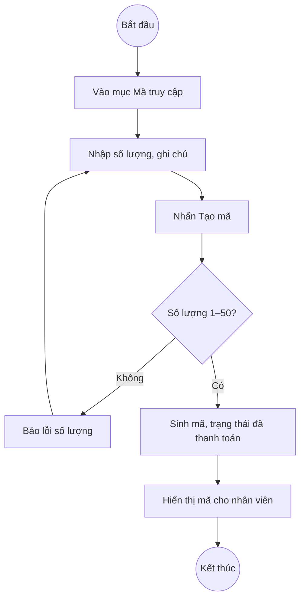

---

### UC12 — Tra cứu mã truy cập

| | |
|---|---|
| **Use Case Number:** | UC12 |
| **Use Case Name:** | Tra cứu mã truy cập |
| **Actor(s):** | Nhân viên |
| **Maturity:** | Focused |
| **Summary:** | Xem lịch sử các phiên truy cập (online và tiền mặt) để hỗ trợ khách khi có thắc mắc. |

**Basic Course of Events:**

| Actor action | System Response |
|---|---|
| 1. Vào mục "Mã truy cập" | |
| | 2. Hiển thị bảng "Lịch sử phiên truy cập": mã, hình thức, trạng thái, số tiền, ghi chú, tạo lúc, hết hạn dùng (20 dòng/trang) |
| 3. Chọn trạng thái cần lọc **A1** | |
| | 4. Hiển thị các phiên đúng trạng thái |
| 5. Nhấn "Trước" / "Sau" | |
| | 6. Chuyển trang |

**Alternative Paths:**

**A1** — Không lọc

| Actor action | System Response |
|---|---|
| 1. Chọn "Tất cả trạng thái" | |
| | 2. Hiển thị mọi phiên, mới nhất trước |

**Exception Paths:**

- **E1.** Không tải được dữ liệu → "Không tải được dữ liệu".

**Activity:**

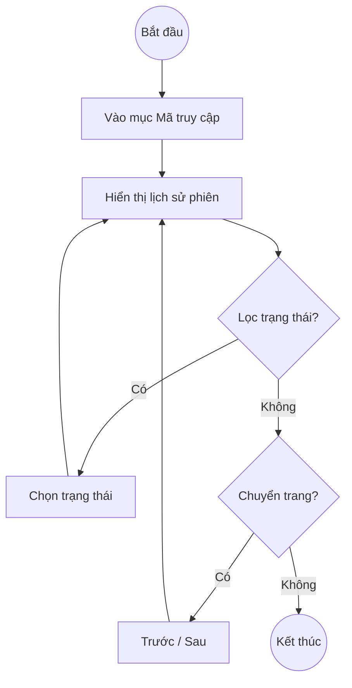

---

### UC13 — Xem thống kê

| | |
|---|---|
| **Use Case Number:** | UC13 |
| **Use Case Name:** | Xem thống kê |
| **Actor(s):** | Nhân viên |
| **Maturity:** | Focused |
| **Summary:** | Theo dõi tình hình hoạt động: doanh thu, độ phủ bản dịch, điểm được quan tâm, ngôn ngữ du khách dùng, câu hỏi gần đây. |

**Basic Course of Events:**

| Actor action | System Response |
|---|---|
| 1. Vào mục "Tổng quan" | |
| | 2. Hiển thị: POI đang hoạt động, số ngôn ngữ bật, độ phủ bản dịch (%), doanh thu, số câu hỏi chatbot, lượt tương tác, tác vụ nền đang chạy |
| | 3. Hiển thị trạng thái bản dịch, phiên truy cập theo trạng thái, POI được quan tâm nhất, ngôn ngữ du khách dùng |
| | 4. Hiển thị 10 câu hỏi gần đây của du khách kèm câu trả lời |
| 5. Nhấn "Tải lại" | |
| | 6. Lấy số liệu mới nhất |

**Alternative Paths:**

**A1** — Quản trị viên xem thống kê

| Actor action | System Response |
|---|---|
| | 1. Hiển thị thêm nút "Dịch + tạo audio tất cả" (xem UC15) |

**Exception Paths:**

- **E1.** Không tải được dữ liệu → "Không tải được dữ liệu".

**Activity:**

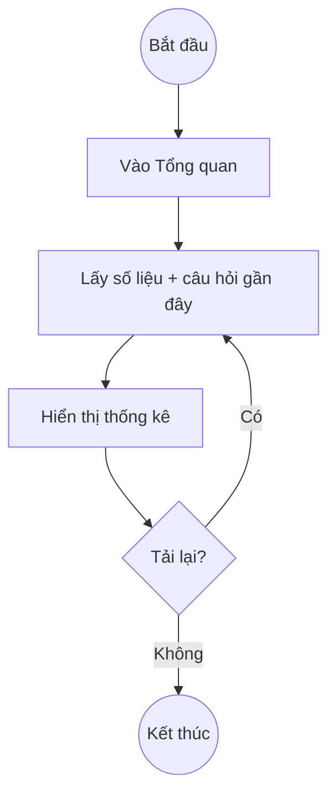

---

## 10.4 Đặc tả Use Case — phía Quản trị viên

> Quản trị viên kế thừa toàn bộ UC09–UC13 của Nhân viên. Mọi UC dưới đây có bước 1 là Đăng nhập (UC09); tài khoản role *staff* gọi các chức năng này bị chặn 403 "Chức năng này chỉ dành cho quản trị viên".

### UC14 — Quản lý điểm tham quan

| | |
|---|---|
| **Use Case Number:** | UC14 |
| **Use Case Name:** | Quản lý điểm tham quan (mở rộng: Nhập giờ mở cửa, tiện ích; Gợi ý mô tả bằng AI) |
| **Actor(s):** | Quản trị viên |
| **Maturity:** | Focused |
| **Summary:** | Thêm, sửa, xóa, tìm kiếm điểm tham quan. Admin chỉ nhập tiếng Việt; hệ thống tự dịch 16 ngôn ngữ và tạo audio ở nền. |

**Basic Course of Events:**

| Actor action | System Response |
|---|---|
| 1. Đăng nhập, vào mục "Điểm tham quan" | |
| | 2. Hiển thị danh sách điểm: thứ tự, mã, tên, tọa độ, bán kính, mức ưu tiên, trạng thái (Hiển thị / Ẩn) |
| 3. Nhập từ khóa vào ô "Tìm theo tên hoặc mã…" | |
| | 4. Hiển thị các điểm khớp |
| 5. Nhấn "+ Thêm POI" **A1, A2** | |
| | 6. Hiển thị form: mã, loại, tên, nội dung thuyết minh, tọa độ (chọn trên bản đồ), bán kính kích hoạt, mức ưu tiên, thứ tự, ảnh, thông tin chi tiết |
| 7. Nhập thông tin, chạm bản đồ để chọn tọa độ **A3, A4** | |
| 8. Nhấn "Lưu" | |
| | 9. Kiểm tra dữ liệu. **E1, E2, E3** |
| | 10. Lưu điểm, xếp hàng dịch + tạo audio cho mọi ngôn ngữ đang bật, báo "Đã tạo POI - đang dịch đa ngôn ngữ ở nền" |
| | 11. Cập nhật lại danh sách |

**Alternative Paths:**

**A1** — Sửa điểm

| Actor action | System Response |
|---|---|
| 1. Nhấn "Sửa" ở 1 điểm | |
| | 2. Mở form với dữ liệu hiện tại |
| 3. Sửa thông tin, nhấn "Lưu" | |
| | 4. Đổi tên/nội dung → bản dịch cũ hết hiệu lực, dịch lại toàn bộ. Chỉ đổi lưu ý → chỉ dịch lại phần lưu ý. Đổi tọa độ/giờ mở cửa → không cần dịch lại |

**A2** — Xóa điểm

| Actor action | System Response |
|---|---|
| 1. Nhấn "Xóa" ở 1 điểm | |
| | 2. Hiển thị xác nhận "Mọi bản dịch và audio sẽ bị xóa theo" |
| 3. Nhấn OK | |
| | 4. Xóa điểm + bản dịch, gỡ điểm khỏi mọi lộ trình, cập nhật danh sách |
| 5. Nhấn Cancel | |
| | 6. Đóng xác nhận, không xóa |

**A3** — Nhập giờ mở cửa, tiện ích (`<<extend>>`)

| Actor action | System Response |
|---|---|
| 1. Trong khung "Thông tin chi tiết": nhập giờ từng ngày (vd `06:00-11:30, 13:30-21:00`, để trống = đóng cửa) | |
| 2. Nhấn "Chép giờ Thứ Hai cho cả tuần" (tùy chọn) | |
| | 3. Chép giờ Thứ Hai sang 6 ngày còn lại |
| 4. Nhập vé vào cửa, thời gian tham quan; tick tiện ích; nhập lưu ý | |

**A4** — Gợi ý mô tả bằng AI (`<<extend>>`)

| Actor action | System Response |
|---|---|
| 1. Nhấn "Gợi ý bằng AI" | |
| | 2. AI viết lại nội dung thuyết minh, hiển thị để xem trước |
| 3. Nhấn OK để dùng (Cancel để giữ nội dung cũ) | |
| | 4. Thay nội dung trong form |

**Exception Paths:**

- **E1.** Bỏ trống trường bắt buộc / tọa độ, bán kính ngoài khoảng / mã có dấu cách → báo lỗi tại trường (422).
- **E2.** Mã POI đã tồn tại → "Mã POI '…' đã tồn tại".
- **E3.** Giờ sai định dạng → "Thứ Hai: "6h-21" không đúng dạng, ví dụ 06:00-21:00"; 2 khung giờ chồng nhau → "… có 2 khung giờ chồng nhau"; giờ đóng trước giờ mở → báo lỗi.
- **E4.** Chưa cấu hình AI → không gợi ý được, giữ nguyên nội dung.

**Activity:**

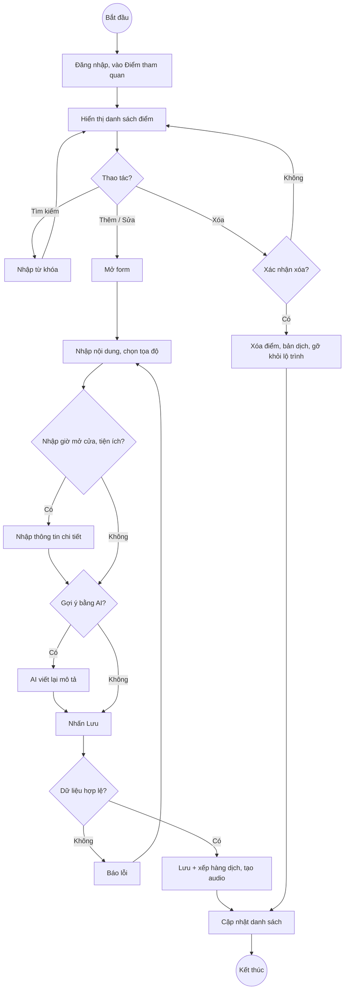

---

### UC15 — Quản lý bản dịch và audio

| | |
|---|---|
| **Use Case Number:** | UC15 |
| **Use Case Name:** | Quản lý bản dịch và audio (mở rộng: Sửa tay bản dịch) |
| **Actor(s):** | Quản trị viên |
| **Maturity:** | Focused |
| **Summary:** | Theo dõi trạng thái dịch/audio của từng điểm theo 16 ngôn ngữ, yêu cầu dịch lại, sửa tay bản dịch. |

**Basic Course of Events:**

| Actor action | System Response |
|---|---|
| 1. Ở mục "Điểm tham quan", nhấn "Bản dịch" của 1 điểm | |
| | 2. Hiển thị bảng theo ngôn ngữ: trạng thái (pending / processing / ready / failed, kèm nhãn "cũ" nếu không còn khớp nội dung gốc), nguồn (machine / manual), tên bản dịch, audio nghe thử |
| 3. Nhấn "Dịch các ngôn ngữ còn thiếu" **A1, A3** | |
| | 4. Xếp hàng dịch + tạo audio ở nền cho ngôn ngữ còn thiếu/cũ, báo "Đã xếp hàng N ngôn ngữ" |
| | 5. Hiển thị "Đang xử lý, trang tự cập nhật...", 3 giây tải lại trạng thái 1 lần cho đến khi xong |

**Alternative Paths:**

**A1** — Dịch lại toàn bộ (ghi đè)

| Actor action | System Response |
|---|---|
| 1. Nhấn "Dịch lại toàn bộ (ghi đè)" | |
| | 2. Hỏi "Ghi đè cả bản sửa tay?" |
| 3. Nhấn OK | |
| | 4. Dịch lại mọi ngôn ngữ, kể cả bản admin đã sửa tay |

**A2** — Sửa tay bản dịch (`<<extend>>`)

| Actor action | System Response |
|---|---|
| 1. Nhấn "Sửa tay" ở 1 ngôn ngữ | |
| | 2. Hiển thị tên + mô tả bản dịch hiện tại, ô "Tạo lại audio" |
| 3. Sửa nội dung, nhấn "Lưu" | |
| | 4. Lưu bản dịch đánh dấu *sửa tay* (dịch máy không ghi đè), tạo lại audio nếu chọn, báo "Đã lưu bản dịch" |

**A3** — Dịch lại 1 ngôn ngữ

| Actor action | System Response |
|---|---|
| 1. Nhấn "Dịch lại" ở 1 ngôn ngữ | |
| | 2. Dịch lại riêng ngôn ngữ đó (ghi đè) |

**A4** — Dịch toàn bộ hệ thống

| Actor action | System Response |
|---|---|
| 1. Ở "Tổng quan", nhấn "Dịch + tạo audio tất cả" | |
| | 2. Xếp hàng mọi điểm + lộ trình, báo "Đã xếp hàng N POI. Quá trình chạy nền, có thể mất vài phút." |

**Exception Paths:**

- **E1.** Dịch máy lỗi (mất mạng, bị giới hạn) → ngôn ngữ đó trạng thái *lỗi* kèm lý do, không ảnh hưởng ngôn ngữ khác; tạo audio lỗi vẫn giữ bản dịch chữ.
- **E2.** Sửa tay tiếng Việt → "Muốn sửa tiếng Việt hãy sửa trực tiếp nội dung POI".

**Activity:**

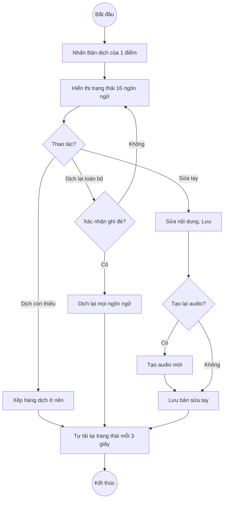

---

### UC16 — Quản lý lộ trình

| | |
|---|---|
| **Use Case Number:** | UC16 |
| **Use Case Name:** | Quản lý lộ trình |
| **Actor(s):** | Quản trị viên |
| **Maturity:** | Focused |
| **Summary:** | Tạo, sửa, xóa lộ trình tham quan gồm nhiều điểm theo thứ tự; tên/mô tả lộ trình tự dịch đa ngôn ngữ. |

**Basic Course of Events:**

| Actor action | System Response |
|---|---|
| 1. Vào mục "Lộ trình" | |
| | 2. Hiển thị danh sách: mã, tên, các điểm theo thứ tự, thời gian ước tính |
| 3. Nhấn "+ Thêm lộ trình" **A1, A2** | |
| | 4. Hiển thị form: mã, tên, mô tả, thời gian ước tính, danh sách điểm để chọn |
| 5. Nhấn lần lượt các điểm để thêm theo thứ tự (nhấn "x" để bỏ) | |
| 6. Nhấn "Lưu" | |
| | 7. Kiểm tra dữ liệu. **E1, E2, E3** |
| | 8. Lưu lộ trình, xếp hàng dịch tên/mô tả, cập nhật danh sách |

**Alternative Paths:**

**A1** — Sửa lộ trình

| Actor action | System Response |
|---|---|
| 1. Nhấn "Sửa" ở 1 lộ trình | |
| | 2. Mở form với dữ liệu hiện tại; lưu lại như bước 6–8 |

**A2** — Xóa lộ trình

| Actor action | System Response |
|---|---|
| 1. Nhấn "Xóa" | |
| | 2. Hỏi "Xóa lộ trình này?" |
| 3. Nhấn OK | |
| | 4. Xóa lộ trình (các điểm tham quan giữ nguyên) |

**Exception Paths:**

- **E1.** Mã lộ trình đã tồn tại → "Mã lộ trình '…' đã tồn tại".
- **E2.** Một điểm bị chọn 2 lần → "Một POI không được lặp lại trong lộ trình".
- **E3.** Điểm không tồn tại → "POI không tồn tại: …".

**Activity:**

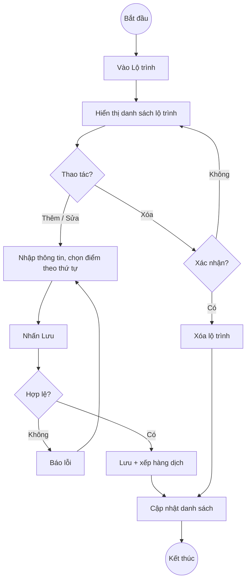

---

### UC17 — Quản lý kiến thức chatbot

| | |
|---|---|
| **Use Case Number:** | UC17 |
| **Use Case Name:** | Quản lý kiến thức chatbot |
| **Actor(s):** | Quản trị viên |
| **Maturity:** | Focused |
| **Summary:** | Thêm, sửa, xóa bài viết kiến thức (giờ mở cửa, quy định trang phục, đường đi…) làm nguồn trả lời cho chatbot. |

**Basic Course of Events:**

| Actor action | System Response |
|---|---|
| 1. Vào mục "Kiến thức chatbot" | |
| | 2. Hiển thị danh sách bài viết: tiêu đề, nội dung, trạng thái (Dùng / Tắt) |
| 3. Nhấn "+ Thêm bài viết" **A1, A2** | |
| | 4. Hiển thị form: tiêu đề, nội dung, từ khóa (phân cách dấu phẩy), "Dùng cho chatbot" |
| 5. Nhập thông tin, nhấn "Lưu" | |
| | 6. Kiểm tra dữ liệu. **E1** |
| | 7. Lưu bài viết; chatbot dùng ngay ở câu hỏi tiếp theo |

**Alternative Paths:**

**A1** — Sửa bài viết / bỏ tick "Dùng cho chatbot" để tạm ẩn

| Actor action | System Response |
|---|---|
| 1. Nhấn "Sửa", thay đổi, nhấn "Lưu" | |
| | 2. Cập nhật; bài bị bỏ tick không được đưa cho chatbot |

**A2** — Xóa bài viết

| Actor action | System Response |
|---|---|
| 1. Nhấn "Xóa" | |
| | 2. Hỏi "Xóa bài viết?" |
| 3. Nhấn OK | |
| | 4. Xóa bài viết, cập nhật danh sách |

**Exception Paths:**

- **E1.** Bỏ trống tiêu đề / nội dung → báo lỗi tại trường.

**Activity:**

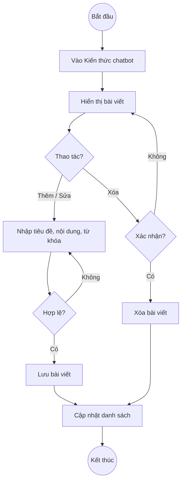

---

### UC18 — Quản lý ngôn ngữ

| | |
|---|---|
| **Use Case Number:** | UC18 |
| **Use Case Name:** | Quản lý ngôn ngữ |
| **Actor(s):** | Quản trị viên |
| **Maturity:** | Focused |
| **Summary:** | Bật/tắt các ngôn ngữ hiển thị cho du khách. |

**Basic Course of Events:**

| Actor action | System Response |
|---|---|
| 1. Vào mục "Ngôn ngữ" | |
| | 2. Hiển thị 16 ngôn ngữ: mã, tên, mã dịch máy, giọng đọc, ô "Bật" |
| 3. Tick / bỏ tick "Bật" ở 1 ngôn ngữ | |
| | 4. Cập nhật trạng thái, báo "Đã cập nhật". **E1** |
| | 5. Ngôn ngữ tắt biến mất khỏi ô chọn ngôn ngữ của app; ngôn ngữ bật lại được dịch ở nền khi có khách chọn |

**Alternative Paths:** Không có.

**Exception Paths:**

- **E1.** Tắt Tiếng Việt (ngôn ngữ gốc) hoặc English (ngôn ngữ dự phòng) → "Không thể tắt ngôn ngữ gốc hoặc ngôn ngữ dự phòng", ô tick trở lại như cũ.

**Activity:**

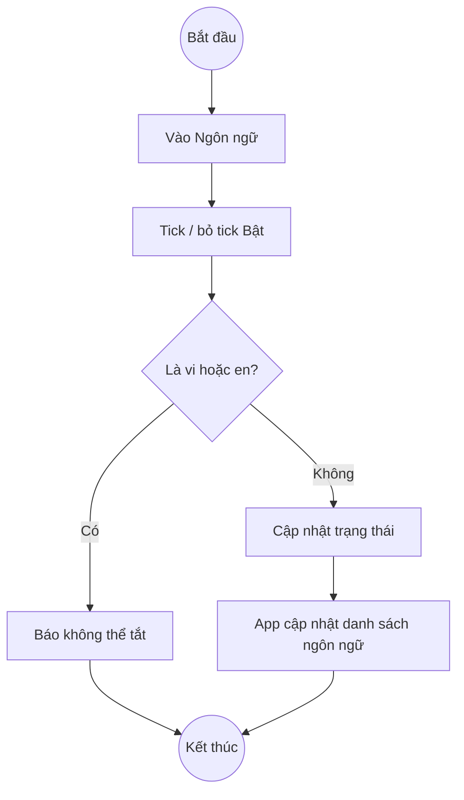

---

### UC19 — Quản lý tài khoản

| | |
|---|---|
| **Use Case Number:** | UC19 |
| **Use Case Name:** | Quản lý tài khoản |
| **Actor(s):** | Quản trị viên |
| **Maturity:** | Focused |
| **Summary:** | Tạo tài khoản nhân viên / quản trị viên, khóa hoặc mở khóa tài khoản. |

**Basic Course of Events:**

| Actor action | System Response |
|---|---|
| 1. Vào mục "Tài khoản" (chỉ admin thấy mục này) | |
| | 2. Hiển thị danh sách: tên đăng nhập, họ tên, vai trò, trạng thái, lần đăng nhập cuối |
| 3. Nhấn "+ Thêm tài khoản" **A1** | |
| | 4. Hiển thị form: tên đăng nhập, mật khẩu (≥ 8 ký tự), họ tên, vai trò (staff / admin) |
| 5. Nhập thông tin, nhấn "Tạo" | |
| | 6. Kiểm tra dữ liệu. **E1, E2** |
| | 7. Lưu tài khoản (mật khẩu mã hóa bcrypt), cập nhật danh sách |

**Alternative Paths:**

**A1** — Khóa / mở khóa tài khoản

| Actor action | System Response |
|---|---|
| 1. Nhấn "Khóa" (hoặc "Mở khóa") ở 1 tài khoản khác | |
| | 2. Cập nhật trạng thái; tài khoản bị khóa không đăng nhập được nữa và bị đăng xuất ở lần gọi kế tiếp. **E3** |

**Exception Paths:**

- **E1.** Tên đăng nhập đã tồn tại → "Tên đăng nhập đã tồn tại".
- **E2.** Mật khẩu dưới 8 ký tự / tên đăng nhập có ký tự đặc biệt → báo lỗi tại trường.
- **E3.** Dòng của chính mình không có nút "Khóa"; nếu gọi API tự khóa / tự hạ quyền → "Không thể tự khóa hoặc tự hạ quyền chính mình".

**Activity:**

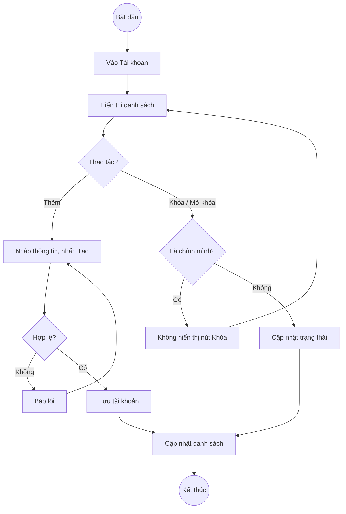

---

### UC20 — Thu hồi mã truy cập

| | |
|---|---|
| **Use Case Number:** | UC20 |
| **Use Case Name:** | Thu hồi mã truy cập |
| **Actor(s):** | Quản trị viên |
| **Maturity:** | Focused |
| **Summary:** | Vô hiệu hóa một mã truy cập (bán nhầm, hoàn tiền, nghi lạm dụng); du khách đang dùng mã đó bị đăng xuất. |

**Basic Course of Events:**

| Actor action | System Response |
|---|---|
| 1. Vào mục "Mã truy cập", tìm phiên cần thu hồi (UC12) | |
| 2. Nhấn "Thu hồi" | |
| | 3. Hỏi "Thu hồi quyền truy cập này?" **A1** |
| 4. Nhấn OK | |
| | 5. Chuyển phiên sang *đã hủy*, cập nhật danh sách |
| | 6. Lần gọi tiếp theo từ app của khách bị từ chối (401 "Quyền truy cập không còn hiệu lực") → app về màn hình mua vé, báo "Hết hạn sử dụng, vui lòng nhập mã mới" |

**Alternative Paths:**

**A1** — Hủy thao tác

| Actor action | System Response |
|---|---|
| 1. Nhấn Cancel | |
| | 2. Đóng xác nhận, phiên giữ nguyên |

**Exception Paths:**

- **E1.** Tài khoản staff nhấn thu hồi → 403 "Chức năng này chỉ dành cho quản trị viên" (nút này chỉ hiện với admin).

**Activity:**

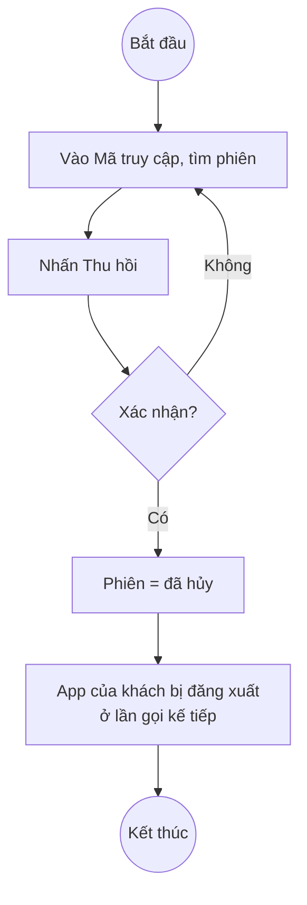
